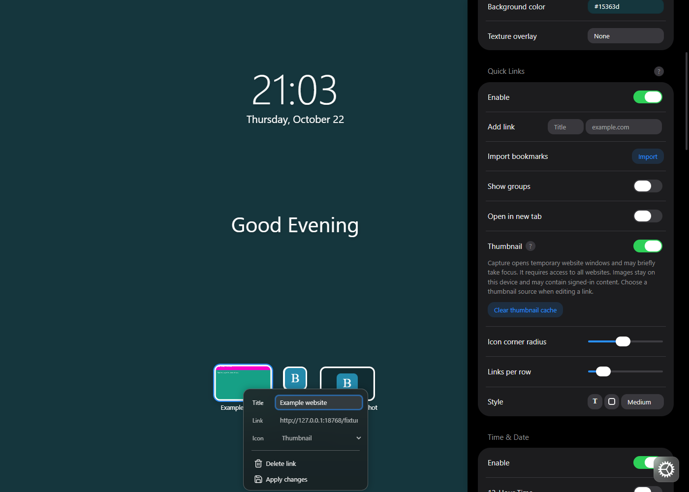

# Local website thumbnails

This draft adds a **Thumbnails** Quick Links style. Existing links initially show their icons. In the link editor,
choose **Local screenshot**, **Local file**, or **Image URL**, then apply the change. **Refresh thumbnail** updates
the saved screenshot or downloads the image again. Files must be chosen again to replace them.

Local screenshot capture is disabled by default. Enable **Local thumbnail capture** in Quick Links settings to
request optional access to all websites. Chrome and Edge declare this through `optional_host_permissions`;
Firefox uses host patterns in `optional_permissions` to retain the existing Firefox 109 manifest minimum.
The declaration of a minimum version does not establish that this feature has been tested on that version.

The background script serializes capture requests and deduplicates requests for the same link and URL. It checks
the saved source and permission before opening a temporary, muted window. After loading settles, it focuses
the window briefly and captures its active tab with `tabs.captureVisibleTab`. It checks tab
identity and URL before and after capture, resizes the image, and closes its own window in `finally`.
The window is visible during capture. After capture it returns focus to the previous browser window if the
capture window still has focus. Unfocused capture intermittently stalled in the Chromium integration runs;
this implementation does not promise invisible capture. Native Windows/macOS behavior still needs acceptance testing.

Images are 512 × 320 JPEGs stored in a separate IndexedDB database. They are not put in synced settings,
exports, or a screenshot service. The cache holds at most 100 images or 8 MiB, evicting the oldest writes.
Each image is tied to its link ID, website URL, and source. Failed refreshes preserve the previous image.
Deleting a link removes its image; **Clear thumbnail cache** and resetting settings remove cached images.
Missing screenshots are generated on demand while the thumbnail style is shown and capture is enabled.
There is no periodic refresh or background crawling of all saved links.

Screenshots use the browser's regular session and may contain signed-in information. Private-tab capture is
rejected. Image files and URLs also work in the online build; URL downloads depend on CORS or granted host
access and omit credentials. If an image URL cannot be downloaded, save the image as a local file instead.
Local screenshot capture is unavailable in the online build.

## Validation

On 2026-10-21 the extension builds passed integration checks in Chrome 156.0.8078.47, Edge 155.0.4283.62,
and Firefox 158.0.1 on Linux with Docker, Xvfb and Openbox. Checks covered local opt-out, capture and decoded
image markers, cached reload, changed-link rejection, preservation of the previous image on failure, cancellation
during cache clearing, file/URL overrides, style changes, and closing every temporary window.

The integration copies received a test-only mandatory host grant. The shipped manifests still request optional
access at runtime; the actual permission dialog and native desktop focus behavior were not exercised.
The project checks passed: format, types, lint, 24 tests (69 test steps), and all four builds. The thumbnail
labels, warning, statuses, and actionable errors are translated in all 46 supported locales. Locale coverage,
refreshing older translation caches, and switching the warning/status language are covered by tests.

[Measurements](thumbnails/validation.json) contain synthetic image checks and browser versions. The
[sample image](thumbnails/sample.jpg) and interface screenshot below contain only the synthetic fixture and
default Bonjourr interface, without personal browser profiles, logs, account names, or local filesystem paths.

Run `deno task format`, `deno task types`, `deno lint`, `deno task test`, and `deno task build`.

For each extension build, verify permission denial/grant/revocation, missing-image capture, manual refresh,
tab closure, changed URLs, failed refresh retaining the previous image, file and URL overrides, cache clearing,
and returning to the original link styles. Observe window visibility, focus, and cleanup on native desktops.
Authenticated websites, CAPTCHA, long-running applications, and extension-store review need separate checks.

API references: [captureVisibleTab](https://developer.mozilla.org/en-US/docs/Mozilla/Add-ons/WebExtensions/API/tabs/captureVisibleTab),
[optional host permissions](https://developer.mozilla.org/en-US/docs/Mozilla/Add-ons/WebExtensions/manifest.json/optional_host_permissions),
[Firefox optional permissions](https://developer.mozilla.org/en-US/docs/Mozilla/Add-ons/WebExtensions/manifest.json/optional_permissions).
